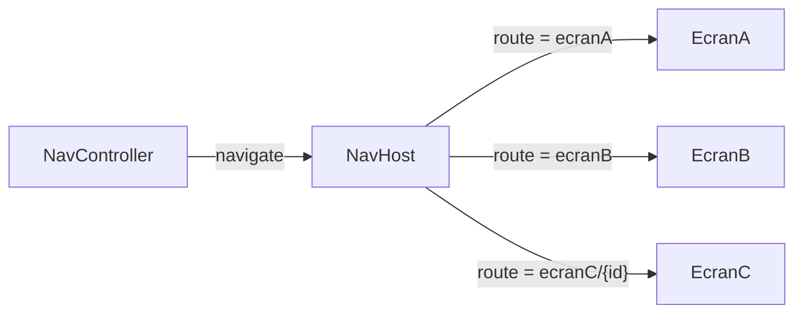
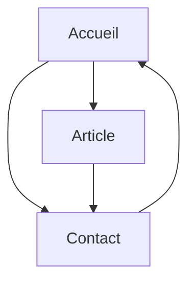

import Tabs from '@theme/Tabs';
import TabItem from '@theme/TabItem';

# 7.1 – Activités et navigation avec Jetpack Compose 🧭

Code de la recette : [ComposeNavigation](https://github.com/departement-info-cem/3M5-Intro-Mobile/tree/main/code/ComposeNavigation)

**Idée :** une seule activité, plusieurs **écrans** (fonctions `@Composable`). Un `NavHost` associe chaque **route** (une `String`) à un écran, et un `NavController` permet de naviguer.



---

## Étape 1 — Ajouter la dépendance

<Tabs>
<TabItem value="toml" label="gradle/libs.versions.toml" default>

Ajoute la version dans `[versions]` et la librairie dans `[libraries]` :

```toml title="gradle/libs.versions.toml"
[versions]
# ... versions existantes
navigationCompose = "2.10.2"

[libraries]
# ... librairies existantes
androidx-navigation-compose = { group = "androidx.navigation", name = "navigation-compose", version.ref = "navigationCompose" }
```

</TabItem>
<TabItem value="gradle" label="app/build.gradle.kts">

```kotlin title="app/build.gradle.kts"
dependencies {
    // ... dépendances existantes
    implementation(libs.androidx.navigation.compose)
}
```

</TabItem>
<TabItem value="direct" label="Sans catalogue (version directe)">

Si ton projet n'utilise pas `libs.versions.toml` :

```kotlin title="app/build.gradle.kts"
dependencies {
    implementation("androidx.navigation:navigation-compose:2.10.2")
}
```

</TabItem>
</Tabs>

Puis **Sync Now** 🐘.

:::note Version
`2.10.2` est la version utilisée dans le dépôt du cours. Android Studio souligne la ligne en jaune s'il existe une version plus récente : `Alt+Enter` pour mettre à jour.
:::

---

## Étape 2 — Définir les routes dans un composable `Navigation`

```kotlin title="MainActivity.kt"
import androidx.compose.runtime.Composable
import androidx.compose.ui.Modifier
import androidx.navigation.NavHostController
import androidx.navigation.compose.NavHost
import androidx.navigation.compose.composable
import androidx.navigation.compose.rememberNavController

@Composable
fun Navigation(
    modifier: Modifier = Modifier,
    navController: NavHostController = rememberNavController()
) {
    NavHost(
        navController = navController,
        startDestination = "ecranA"          // premier écran affiché
    ) {
        // on passe le navController à l'écran pour qu'il puisse naviguer à son tour
        composable(route = "ecranA") { EcranA(navController, modifier) }
        composable(route = "ecranB") { EcranB(navController, modifier) }
        // route avec PARAMÈTRE entre accolades
        composable(route = "ecranC/{id}") { backStackEntry ->
            val id: String? = backStackEntry.arguments?.getString("id")
            EcranC(navController, modifier, id)
        }
    }
}
```

---

## Étape 3 — Appeler `Navigation()` dans `setContent`

```kotlin title="MainActivity.kt"
class MainActivity : ComponentActivity() {
    override fun onCreate(savedInstanceState: Bundle?) {
        super.onCreate(savedInstanceState)
        enableEdgeToEdge()
        setContent {
            ComposeNavigationTheme {      // ← le nom du thème de TON projet
                Navigation()
            }
        }
    }
}
```

---

## Étape 4 — Naviguer entre les écrans

| Action | Code |
|---|---|
| Aller vers un écran | `navController.navigate("ecranB")` |
| Aller vers un écran avec paramètre | `navController.navigate("ecranC/20")` |
| Revenir en arrière | `navController.popBackStack()` |
| Aller vers un écran en vidant la pile jusqu'à lui | `navController.navigate("accueil") { popUpTo("accueil") { inclusive = true } }` |

```kotlin title="Écrans"
import androidx.compose.foundation.layout.*
import androidx.compose.material.icons.Icons
import androidx.compose.material.icons.automirrored.filled.ArrowBack
import androidx.compose.material3.*
import androidx.compose.runtime.Composable
import androidx.compose.ui.Modifier
import androidx.compose.ui.unit.dp
import androidx.navigation.NavHostController

@Composable
fun EcranA(navController: NavHostController, modifier: Modifier = Modifier) {
    Scaffold(modifier = modifier.fillMaxSize()) { padding ->
        Column(Modifier.padding(padding).padding(16.dp)) {
            Text("Ceci est l'écran A")
            Button(onClick = { navController.navigate("ecranB") }) {
                Text("Vers Écran B")
            }
        }
    }
}

@Composable
fun EcranB(navController: NavHostController, modifier: Modifier = Modifier) {
    Scaffold(modifier = modifier.fillMaxSize()) { padding ->
        Column(Modifier.padding(padding).padding(16.dp)) {
            Button(onClick = { navController.navigate("ecranA") }) { Text("Vers Écran A") }
            Button(onClick = { navController.navigate("ecranC/20") }) { Text("Vers Écran C avec id 20") }
            Button(onClick = { navController.navigate("ecranC/99") }) { Text("Vers Écran C avec id 99") }
        }
    }
}

@OptIn(ExperimentalMaterial3Api::class)
@Composable
fun EcranC(navController: NavHostController, modifier: Modifier, id: String?) {
    Scaffold(
        topBar = {
            TopAppBar(
                title = { Text("Écran C") },
                navigationIcon = {
                    IconButton(onClick = { navController.popBackStack() }) {
                        Icon(Icons.AutoMirrored.Filled.ArrowBack, contentDescription = "Retour")
                    }
                }
            )
        }
    ) { padding ->
        Text(
            text = id ?: "Aucun ID fourni",
            modifier = Modifier.padding(padding).padding(16.dp)
        )
    }
}
```

:::info Icônes
`Icons.AutoMirrored.Filled.ArrowBack` est dans les icônes de base. Pour d'autres icônes, voir [Logo et icônes](/android/logo-icones).
:::

---

## Étape 5 — Paramètres typés et optionnels

```kotlin
import androidx.navigation.NavType
import androidx.navigation.navArgument

// Paramètre Int obligatoire
composable(
    route = "detail/{id}",
    arguments = listOf(navArgument("id") { type = NavType.IntType })
) { entry ->
    val id: Int = entry.arguments?.getInt("id") ?: 0
    Detail(navController, id)
}

// Paramètre OPTIONNEL (syntaxe ?nom={nom}) avec valeur par défaut
composable(
    route = "accueil?nom={nom}",
    arguments = listOf(navArgument("nom") {
        type = NavType.StringType
        defaultValue = ""
    })
) { entry ->
    val nom: String = entry.arguments?.getString("nom") ?: ""
    Accueil(navController, nom)
}
// Navigation : navController.navigate("accueil?nom=${Uri.encode(nom)}")
// et startDestination = "accueil?nom={nom}"
```

:::tip `Uri.encode`
Si le paramètre peut contenir des espaces ou `/`, encode-le : `android.net.Uri.encode(nom)`.
:::

---

## Exercice Navigation Transfert (piste de solution)



```kotlin title="NavigationTransfert.kt"
import android.net.Uri
import android.widget.NumberPicker
import androidx.compose.foundation.layout.*
import androidx.compose.material3.*
import androidx.compose.runtime.*
import androidx.compose.ui.Alignment
import androidx.compose.ui.Modifier
import androidx.compose.ui.unit.dp
import androidx.compose.ui.viewinterop.AndroidView
import androidx.navigation.NavHostController
import androidx.navigation.NavType
import androidx.navigation.compose.NavHost
import androidx.navigation.compose.composable
import androidx.navigation.compose.rememberNavController
import androidx.navigation.navArgument

@Composable
fun NavigationTransfert(navController: NavHostController = rememberNavController()) {
    NavHost(navController, startDestination = "accueil?nom={nom}") {
        composable(
            "accueil?nom={nom}",
            arguments = listOf(navArgument("nom") { type = NavType.StringType; defaultValue = "" })
        ) { entry ->
            Accueil(navController, entry.arguments?.getString("nom") ?: "")
        }
        composable(
            "article/{numero}",
            arguments = listOf(navArgument("numero") { type = NavType.IntType })
        ) { entry ->
            Article(navController, entry.arguments?.getInt("numero") ?: 0)
        }
        composable("contact") { Contact(navController) }
    }
}

@Composable
fun Accueil(navController: NavHostController, nom: String) {
    var numero by remember { mutableIntStateOf(1) }
    val message = if (nom.isEmpty()) "Bonjour" else "Bonjour $nom"
    Scaffold { padding ->
        Column(
            Modifier.padding(padding).fillMaxSize(),
            horizontalAlignment = Alignment.CenterHorizontally,
            verticalArrangement = Arrangement.Center
        ) {
            Text(message)
            // NumberPicker est un composant Android « classique » → AndroidView
            AndroidView(factory = { ctx ->
                NumberPicker(ctx).apply {
                    minValue = 1
                    maxValue = 10
                    setOnValueChangedListener { _, _, nouveau -> numero = nouveau }
                }
            })
            Button(onClick = { navController.navigate("article/$numero") }) { Text("Article") }
            Button(onClick = { navController.navigate("contact") }) { Text("Contact") }
        }
    }
}

@Composable
fun Article(navController: NavHostController, numero: Int) {
    Scaffold { padding ->
        Column(Modifier.padding(padding).padding(16.dp)) {
            Text("Article $numero", style = MaterialTheme.typography.headlineMedium)
            Text("Lorem ipsum dolor sit amet, consectetur adipiscing elit…")
            Spacer(Modifier.weight(1f))
            Button(
                onClick = { navController.navigate("contact") },
                modifier = Modifier.align(Alignment.CenterHorizontally)
            ) { Text("Contact") }
        }
    }
}

@Composable
fun Contact(navController: NavHostController) {
    var nom by remember { mutableStateOf("") }
    Scaffold { padding ->
        Column(Modifier.padding(padding).padding(16.dp)) {
            TextField(value = nom, onValueChange = { nom = it }, label = { Text("Nom") })
            Button(onClick = {
                val nomFinal = if (nom.isBlank()) "X" else nom
                navController.navigate("accueil?nom=${Uri.encode(nomFinal)}") {
                    // on vide la pile : Accueil redevient la racine (le bouton « retour » quitte l'appli)
                    popUpTo(navController.graph.id) { inclusive = true }
                }
            }) { Text("Accueil") }
        }
    }
}
```

---

## (Optionnel) E.T. téléphone maison 📞 — Intent

Un **Intent** demande à Android d'ouvrir une autre application (téléphone, navigateur, carte…).

```kotlin
import android.content.Intent
import android.net.Uri
import androidx.compose.ui.platform.LocalContext

@Composable
fun BoutonAppeler() {
    val context = LocalContext.current
    Button(onClick = {
        // ACTION_DIAL ouvre le composeur avec le numéro : aucune permission requise
        val intent = Intent(Intent.ACTION_DIAL, Uri.parse("tel:5145551234"))
        context.startActivity(intent)
    }) {
        Text("Appeler maison")
    }
}
```

Autres Intents utiles :

```kotlin
// Ouvrir une page web
context.startActivity(Intent(Intent.ACTION_VIEW, Uri.parse("https://www.cegepmontpetit.ca")))

// Partager du texte
val partage = Intent(Intent.ACTION_SEND).apply {
    type = "text/plain"
    putExtra(Intent.EXTRA_TEXT, "Regarde cette appli !")
}
context.startActivity(Intent.createChooser(partage, "Partager avec"))
```
