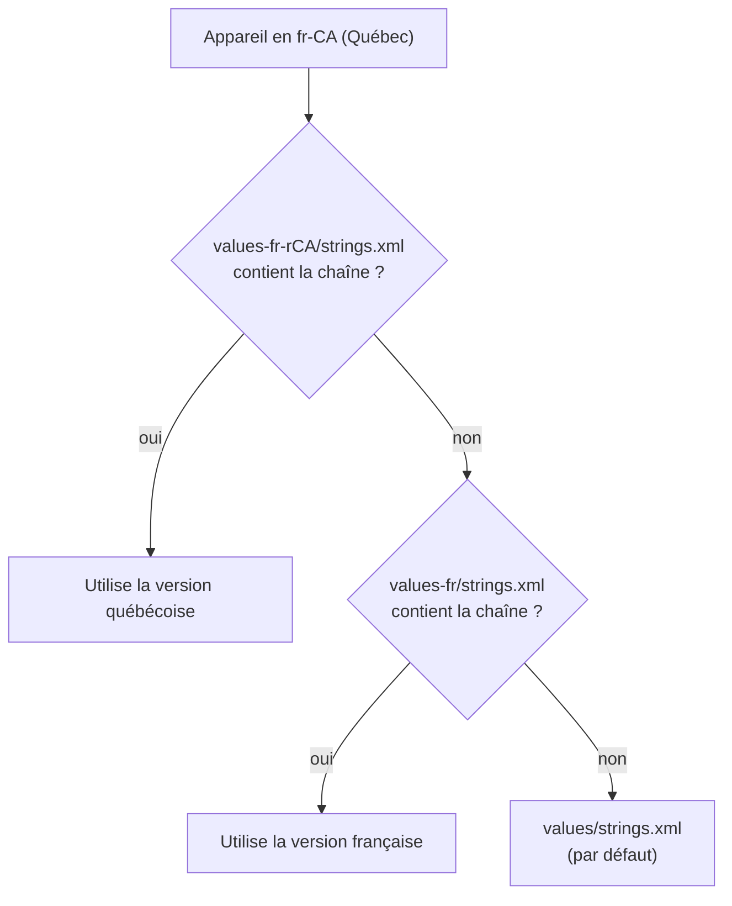

import Tabs from '@theme/Tabs';
import TabItem from '@theme/TabItem';

# 8.2 / 9.1 – Rendre une application multilingue (i18n) 🌐

Code de la recette : [ComposeMultilingue](https://github.com/departement-info-cem/3M5-Intro-Mobile/tree/main/code/ComposeMultilingue)
📚 [Ressources de chaînes (doc Android)](https://developer.android.com/guide/topics/resources/string-resource?hl=fr) · [Translations Editor](https://developer.android.com/studio/write/translations-editor)

---

## Le principe : un niveau d'indirection

| ❌ Texte « en dur » | ✅ Texte traduisible |
|---|---|
| `Text("Bonjour")` | `Text(stringResource(R.string.hello))` |

L'appareil cherche la chaîne `R.string.hello` dans le fichier `strings.xml` qui correspond **à la langue du téléphone** :



| Dossier | Utilisé quand… |
|---|---|
| `res/values/` | **Défaut** : aucune traduction trouvée. Doit contenir **TOUTES** les chaînes. |
| `res/values-fr/` | Appareil en français (France, Canada, Belgique…) |
| `res/values-fr-rCA/` | Appareil en français **du Canada** (variante régionale, peut être **partielle**) |
| `res/values-es/` | Espagnol, etc. |

:::tip Stratégie de la locale par défaut
On met généralement **l'anglais** dans `values/` (défaut international), puis `values-fr/` pour une traduction **complète** en français, et `values-fr-rCA/` pour une traduction **partielle** (seulement les mots qui diffèrent au Québec).
:::

---

## Étape 1 — Mettre tous les textes dans `res/values/strings.xml`

Ouvre `app/src/main/res/values/strings.xml` et ajoute une entrée par texte de l'interface :

```xml title="app/src/main/res/values/strings.xml (défaut = anglais)"
<resources>
    <string name="app_name">SupaDupa app</string>
    <string name="titre">SupaDupa app</string>
    <string name="prix">expensive</string>
    <string name="hello_world">Hello the world!</string>
    <string name="bonjour_nom">Hello %1$s!</string>
    <plurals name="you_have_messages">
        <item quantity="one">%d new message</item>
        <item quantity="other">%d new messages</item>
    </plurals>
</resources>
```

:::tip Extraire automatiquement un texte déjà écrit
Place le curseur sur `"Bonjour"` dans `Text("Bonjour")` → `Alt+Enter` → **Extract string resource** → donne un nom (`bonjour`). Android Studio crée l'entrée dans `strings.xml` et remplace le code par `stringResource(R.string.bonjour)`.
:::

**Règles de nommage :** minuscules, chiffres et `_` seulement (`ecran_vote_titre`). Pas d'espaces, pas de tirets, pas d'accents.

---

## Étape 2 — Créer le fichier de traduction française

<Tabs>
<TabItem value="assistant" label="Avec l'assistant (recommandé)" default>

1. Dans l'arborescence **Project** (vue *Android*), clic droit sur **`res`** → **New** → **Android Resource File**.
2. **File name** : `strings.xml`
3. **Resource type** : `Values`
4. Dans **Available qualifiers**, sélectionne **Locale** et clique sur **`>>`**.
5. **Language** : `fr: French` — **Specific Region Only** : `Any Region`.
6. **OK** → le fichier est créé dans `res/values-fr/strings.xml`.

Pour la variante québécoise, recommence en choisissant **Specific Region Only : `CA: Canada`** → `res/values-fr-rCA/strings.xml`.

</TabItem>
<TabItem value="manuel" label="À la main">

1. Bascule l'arborescence en vue **Project** (menu déroulant en haut à gauche).
2. Dans `app/src/main/res/`, crée le dossier **`values-fr`**.
3. Dans ce dossier, crée le fichier **`strings.xml`**.
4. Même chose pour **`values-fr-rCA`** (attention : `-r` minuscule + région en MAJUSCULES).

```text
app/src/main/res/
├── values/strings.xml          ← défaut (anglais) : TOUTES les chaînes
├── values-fr/strings.xml       ← français : traduction complète
└── values-fr-rCA/strings.xml   ← québécois : traduction partielle
```

</TabItem>
<TabItem value="editor" label="Avec le Translations Editor">

1. Ouvre `res/values/strings.xml` → lien **Open editor** en haut à droite (ou clic droit → *Open Translations Editor*).
2. Clique sur l'icône **globe 🌐 (Add Locale)** → choisis `French (fr)` ou `French (fr) in Canada (CA)`.
3. Remplis les colonnes de traduction directement dans le tableau.
4. Les cellules en **rouge** = traductions manquantes.

L'éditeur ne fait que **modifier les fichiers `strings.xml`** pour toi.

</TabItem>
</Tabs>

---

## Étape 3 — Traduire

On reprend **les mêmes `name`** et on change seulement la valeur. Pas besoin de répéter `app_name` si on ne veut pas le traduire.

<Tabs>
<TabItem value="fr" label="values-fr/strings.xml" default>

```xml title="app/src/main/res/values-fr/strings.xml"
<?xml version="1.0" encoding="utf-8"?>
<resources>
    <string name="app_name">App en français</string>
    <string name="titre">App en français</string>
    <string name="prix">cher</string>
    <string name="hello_world">Bonjour tout le monde!</string>
    <string name="bonjour_nom">Bonjour %1$s!</string>
    <plurals name="you_have_messages">
        <item quantity="one">%d nouveau message</item>
        <item quantity="other">%d nouveaux messages</item>
    </plurals>
</resources>
```

</TabItem>
<TabItem value="frca" label="values-fr-rCA/strings.xml">

Traduction **partielle** : seulement ce qui diffère du français « général ». Le reste vient de `values-fr`.

```xml title="app/src/main/res/values-fr-rCA/strings.xml"
<?xml version="1.0" encoding="utf-8"?>
<resources>
    <string name="prix">dispendieux</string>
    <string name="hello_world">Salut la gang!</string>
</resources>
```

</TabItem>
</Tabs>

:::danger Les apostrophes françaises !
Dans `strings.xml`, une apostrophe `'` doit être **échappée** avec `\'`, sinon erreur de compilation :

```xml
<string name="ajouter">Ajouter l\'élément</string>     <!-- ✅ -->
<string name="ajouter2">"Ajouter l'élément"</string>   <!-- ✅ entre guillemets doubles -->
<string name="ajouter3">Ajouter l’élément</string>     <!-- ✅ apostrophe typographique ’ -->
<string name="erreur">Ajouter l'élément</string>       <!-- ❌ -->
```
Autres caractères spéciaux : `&` → `&amp;`, `<` → `&lt;`, `"` → `\"`, `@` ou `?` en début de chaîne → `\@`, `\?`.
:::

---

## Étape 4 — Utiliser les chaînes dans le code

### Dans une fonction `@Composable`

```kotlin title="MainActivity.kt"
import androidx.compose.ui.res.pluralStringResource
import androidx.compose.ui.res.stringResource

@OptIn(ExperimentalMaterial3Api::class)
@Composable
fun EcranMultilingue(modifier: Modifier = Modifier) {
    Scaffold(
        topBar = {
            TopAppBar(title = { Text(stringResource(R.string.titre)) })   // titre traduit
        }
    ) { padding ->
        Column(modifier.padding(padding).padding(16.dp)) {
            // Chaîne simple
            Text(stringResource(R.string.prix))

            // Chaîne avec paramètre (%1$s = 1er paramètre String, %1$d = Int)
            Text(stringResource(R.string.bonjour_nom, "Alice"))

            // Pluriels : (id, quantité pour choisir la forme, arguments du format)
            Text(pluralStringResource(R.plurals.you_have_messages, 1, 1))   // 1 nouveau message
            Text(pluralStringResource(R.plurals.you_have_messages, 10, 10)) // 10 nouveaux messages
        }
    }
}
```

:::warning Import de `R`
`R` doit être celui de **ton** application (`import ca.cem.monapp.R`), pas `android.R`.
:::

### En dehors d'un composable (Toast, service, `onClick`…)

`stringResource` ne fonctionne **que** dans une fonction `@Composable`. Ailleurs, on passe par le `Context` :

```kotlin
val context = LocalContext.current          // à récupérer DANS le composable

Button(onClick = {
    // dans une lambda onClick, on n'est plus dans le composable → context.getString
    Toast.makeText(context, context.getString(R.string.prix), Toast.LENGTH_SHORT).show()
}) {
    Text(stringResource(R.string.hello_world))
}
```

```kotlin
// Dans une Activity
val texte: String = getString(R.string.bonjour_nom, "Bob")
```

### Formats disponibles

| Format | Type | Exemple XML | Appel |
|---|---|---|---|
| `%1$s` | String | `Bonjour %1$s` | `stringResource(R.string.x, "Bob")` |
| `%1$d` | Int | `%1$d votes` | `stringResource(R.string.x, 12)` |
| `%1$.2f` | Double/Float | `Moyenne : %1$.2f` | `stringResource(R.string.x, 3.456)` → 3,46 |
| plusieurs | — | `%1$s a voté %2$d étoiles` | `stringResource(R.string.x, "Bob", 4)` |

---

## Étape 5 — Traduire aussi le nom de l'application

Le nom sous l'icône vient de `android:label` dans le manifeste :

```xml title="app/src/main/AndroidManifest.xml"
<application
    android:label="@string/app_name"
    ... >
```

Il suffit donc d'avoir `app_name` dans chaque `strings.xml`.

---

## Étape 6 — Tester

<Tabs>
<TabItem value="emulateur" label="Sur l'émulateur / téléphone" default>

1. **Settings (Paramètres)** → **System** → **Languages & input** → **Languages**.
2. **Add a language** → *Français* → *Canada* (ou *France*).
3. **Glisse** la langue en **première position**.
4. Relance l'application : les textes changent.

Pour tester le défaut : remets *English* en premier (ou une langue sans traduction, ex. *Deutsch* → c'est `values/` qui sera utilisé).

</TabItem>
<TabItem value="preview" label="Avec @Preview (sans émulateur)">

```kotlin
@Preview(name = "Anglais (défaut)", showBackground = true)
@Preview(name = "Français", locale = "fr", showBackground = true)
@Preview(name = "Québécois", locale = "fr-rCA", showBackground = true)
@Composable
fun ApercuMultilingue() {
    MonAppTheme {
        EcranMultilingue()
    }
}
```

Les 3 aperçus s'affichent côte à côte dans l'onglet **Split/Design**.

</TabItem>
</Tabs>

---

## Étape 7 (bonus) — Choix de langue par application (Android 13+)

Permet à l'usager de choisir la langue **de ton app** dans *Paramètres → Applications → TonApp → Langue*.

```kotlin title="app/build.gradle.kts"
android {
    // ...
    androidResources {
        generateLocaleConfig = true
    }
}
```

```properties title="app/src/main/res/resources.properties"
unqualifiedResLocale=en
```

`unqualifiedResLocale` indique la langue de ton dossier `values/` par défaut. Android Studio génère alors automatiquement la liste des langues à partir de tes dossiers `values-xx`.

---

## Checklist i18n ✅

- [ ] **Aucun** texte en dur dans `Text("...")` : tout passe par `stringResource`.
- [ ] `values/strings.xml` contient **toutes** les chaînes (sinon plantage si une langue n'a pas la traduction).
- [ ] Les apostrophes sont échappées (`\'`).
- [ ] Les **données** (sujets, noms saisis par l'usager) ne sont **pas** traduites, seulement l'interface.
- [ ] Le **Translations Editor** n'affiche aucune cellule rouge pour les langues complètes.
- [ ] Testé en changeant la langue du téléphone.

---

## Exercice Multilingue (solution)

> En anglais : titre « SupaDupa app », texte « expensive ». En français : « App en français » / « cher ». En québécois : « App en français » / « dispendieux ».

C'est exactement les fichiers des étapes 1 à 3 ci-dessus, avec ce composable :

```kotlin title="MainActivity.kt"
class MainActivity : ComponentActivity() {
    override fun onCreate(savedInstanceState: Bundle?) {
        super.onCreate(savedInstanceState)
        enableEdgeToEdge()
        setContent {
            ComposeMultilingueTheme {
                EcranMultilingue()
            }
        }
    }
}

@OptIn(ExperimentalMaterial3Api::class)
@Composable
fun EcranMultilingue(modifier: Modifier = Modifier) {
    Scaffold(
        topBar = { TopAppBar(title = { Text(stringResource(R.string.titre)) }) }
    ) { padding ->
        Text(
            text = stringResource(R.string.prix),
            modifier = modifier.padding(padding).padding(16.dp)
        )
    }
}
```

Le titre québécois vient de `values-fr` (absent de `values-fr-rCA`) — c'est la **traduction partielle** en action. Pour le logo, voir [Logo et icônes](/android/logo-icones).
