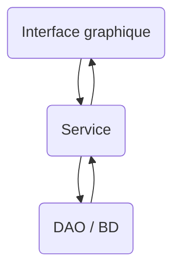

# 11.1 – Structurer son code en Android : packages et service 🧱

---

## 1. Organiser les fichiers en packages

Deux grandes approches (souvent décidées en équipe) :

| Par **fonctionnalité** | Par **type d'objet** |
|---|---|
| `com.monapp.connexion` → `EcranConnexion.kt` | `com.monapp.ecrans` → `EcranConnexion.kt`, `EcranInscription.kt`, `EcranTaches.kt`, `EcranDetailTache.kt` |
| `com.monapp.inscription` → `EcranInscription.kt`, `Utilisateur.kt` | `com.monapp.donnees` → `Tache.kt`, `Utilisateur.kt` |
| `com.monapp.taches` → `EcranTaches.kt`, `Tache.kt` | `com.monapp.service` → `TacheService.kt` |
| `com.monapp.detail` → `EcranDetailTache.kt` | |

### Recette : déplacer sans rien casser

1. Clic droit sur le package principal → **New → Package** → `ecrans`.
2. Sélectionne un fichier `.kt` → **`F6`** (*Refactor → Move*) → choisis le nouveau package.
3. Android Studio met à jour **tous** les `import` et la ligne `package` automatiquement.
4. Compile, lance, commit.

Structure suggérée pour le TP :

```text
ca/cem/sondage/
├── MainActivity.kt          ← setContent { Navigation() }
├── Navigation.kt            ← NavHost + routes
├── ecrans/
│   ├── EcranAccueil.kt
│   ├── EcranAjoutSujet.kt
│   ├── EcranVote.kt
│   ├── EcranResultats.kt
│   └── Tiroir.kt
├── service/
│   ├── DupontService.kt
│   └── Exceptions.kt
└── ui/theme/
```

---

## 2. Recette : décomposer en modèle (entités) et service (actions)

📺 [Vidéo exemple](https://youtu.be/MmpgnWLEa5s) (en Java, mais la méthode est identique)

1. Pars d'un **texte qui décrit l'application**.
2. **Encadre les verbes d'action** et **entoure les noms**.
3. Regroupe les noms qui désignent **la même chose**.
4. Chaque **nom** → une **classe** (entité / modèle de données).
5. Chaque **verbe d'action** → une **méthode de service**.

### Exemple : exercice « Notes »

> On cherche à réaliser une application permettant de **gérer** des (étudiants) et leurs (notes). L'application permet de **créer** des (épreuves) avec une (pondération). L'ensemble des épreuves donne une somme de poids de 100. On peut **créer** des étudiants. On peut **saisir** les notes pour un étudiant et une épreuve. Après chaque saisie, le système **donne le détail** de la situation de l'étudiant.

```kotlin title="donnees/Modele.kt"
data class Etudiant(val id: Long, val nom: String)

data class Epreuve(val id: Long, val nom: String, val ponderation: Int)

data class Note(val etudiantId: Long, val epreuveId: Long, val valeur: Double)

data class Situation(
    val etudiant: Etudiant,
    val notes: Map<Epreuve, Double>,
    val noteCumulee: Double,          // somme pondérée des épreuves faites
    val ponderationFaite: Int         // % du cours déjà évalué
)
```

```kotlin title="service/Exceptions.kt"
class PonderationDepasseException : Exception("La somme des pondérations dépasse 100")
class NomVideException : Exception("Le nom ne peut pas être vide")
class NoteInvalideException : Exception("La note doit être entre 0 et 100")
class EntiteIntrouvableException(message: String) : Exception(message)
```

```kotlin title="service/NotesService.kt"
class NotesService {
    private val etudiants = mutableListOf<Etudiant>()
    private val epreuves = mutableListOf<Epreuve>()
    private val notes = mutableListOf<Note>()
    private var prochainId = 1L

    fun creerEpreuve(nom: String, ponderation: Int): Epreuve {
        if (nom.isBlank()) throw NomVideException()
        if (epreuves.sumOf { it.ponderation } + ponderation > 100) throw PonderationDepasseException()
        val e = Epreuve(prochainId++, nom.trim(), ponderation)
        epreuves.add(e)
        return e
    }

    fun creerEtudiant(nom: String): Etudiant {
        if (nom.isBlank()) throw NomVideException()
        val e = Etudiant(prochainId++, nom.trim())
        etudiants.add(e)
        return e
    }

    fun saisirNote(etudiantId: Long, epreuveId: Long, valeur: Double): Situation {
        if (valeur !in 0.0..100.0) throw NoteInvalideException()
        notes.removeAll { it.etudiantId == etudiantId && it.epreuveId == epreuveId }
        notes.add(Note(etudiantId, epreuveId, valeur))
        return situation(etudiantId)
    }

    fun situation(etudiantId: Long): Situation {
        val etudiant = etudiants.firstOrNull { it.id == etudiantId }
            ?: throw EntiteIntrouvableException("Étudiant $etudiantId introuvable")
        val notesEtudiant: Map<Epreuve, Double> = notes
            .filter { it.etudiantId == etudiantId }
            .associate { n -> epreuves.first { it.id == n.epreuveId } to n.valeur }
        val cumul = notesEtudiant.entries.sumOf { (ep, v) -> v * ep.ponderation / 100 }
        return Situation(etudiant, notesEtudiant, cumul, notesEtudiant.keys.sumOf { it.ponderation })
    }
}
```

---

## 3. L'approche service



**Avantages :**
- Le même service peut servir à une app Android, web ou console.
- On peut **tester** le service avec des tests unitaires, sans interface graphique.
- On peut changer de BD sans toucher au service ni à l'interface.

**Tests pour vérifier si c'est bien fait :**
- ❌ Aucun `import` de BD dans… l'interface (elle passe par le service).
- ❌ Aucun `import androidx.compose…` ni `android.widget.Toast` dans le **service**.

---

## 4. Gérer les erreurs : le service lance, l'interface attrape

Le service n'a pas le droit d'afficher quoi que ce soit → il **lance une exception**. L'interface l'**attrape** et affiche un message.

```kotlin title="ecrans/EcranAjoutSujet.kt"
@Composable
fun EcranAjoutSujet(navController: NavHostController, service: DupontService) {
    var contenu by remember { mutableStateOf("") }
    var erreur by remember { mutableStateOf<String?>(null) }
    val context = LocalContext.current

    Column(Modifier.padding(16.dp)) {
        OutlinedTextField(
            value = contenu,
            onValueChange = { contenu = it; erreur = null },
            label = { Text(stringResource(R.string.contenu_sujet)) },
            isError = erreur != null,
            supportingText = { erreur?.let { Text(it) } }
        )
        Button(onClick = {
            try {
                service.ajouterSujet(contenu)
                navController.popBackStack()          // succès → retour à l'accueil
            } catch (e: TexteVideException) {
                erreur = context.getString(R.string.erreur_sujet_vide)
            } catch (e: TexteCourtException) {
                erreur = context.getString(R.string.erreur_sujet_court)
            } catch (e: DejaPresentException) {
                erreur = context.getString(R.string.erreur_sujet_existant)
            }
        }) {
            Text(stringResource(R.string.ajouter))
        }
    }
}
```

Les messages d'erreur passent par `strings.xml` → ils sont traduits (voir [Multilingue](/android/multilingue)).
