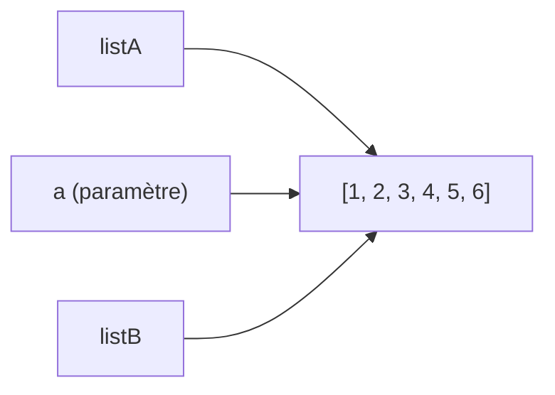

# 4.1 – Structurer son code 🧱

📺 [Vidéo : refactoring dans IntelliJ](https://youtu.be/9Gd83g3elJQ)

On se perd vite dans une fonction de plus de 100 lignes. On voit :
- **quand** et **pourquoi** créer une fonction (nommer, réutiliser, tester) ;
- les outils de **refactor** d'IntelliJ pour le faire **sans rien casser**.

---

## 1. Quand extraire une fonction ?

- Le bloc de code a un **rôle nommable** (« valider les arguments », « télécharger la page »).
- Le même code est **répété** (copier-coller = signal d'alarme).
- La fonction dépasse ~**50 lignes** / un écran.
- On veut **tester** ce bout de logique séparément.
- Un commentaire explique ce que fait un bloc → le commentaire devient le **nom** de la fonction.

### Avant / après

```kotlin title="Avant"
fun main(args: Array<String>) {
    if (args.size != 2) {
        println("Merci de nous fournir 2 arguments")
        return
    }
    val fichier = java.io.File(args[0])
    if (!fichier.exists()) {
        println("Le fichier n'existe pas")
        return
    }
    // ... 80 autres lignes
}
```

```kotlin title="Après"
import java.io.File

fun main(args: Array<String>) {
    if (!argumentsValides(args)) return
    val urls: List<String> = File(args[0]).readLines()
    explorer(urls)
}

fun argumentsValides(args: Array<String>): Boolean {
    if (args.size != 2) {
        println("Merci de nous fournir 2 arguments")
        return false
    }
    if (!File(args[0]).exists()) {
        println("Le fichier n'existe pas")
        return false
    }
    return true
}

fun explorer(urls: List<String>) {
    // ...
}
```

---

## 2. Les refactorings d'IntelliJ (à connaître par cœur)

| Refactoring | Raccourci Windows | Usage |
|---|---|---|
| **Refactor This** (menu) | `Ctrl+Alt+Shift+T` | Liste tous les refactorings possibles |
| **Rename** | `Shift+F6` | Renommer variable/fonction/classe partout |
| **Extract Function/Method** | `Ctrl+Alt+M` | Transformer la sélection en fonction |
| **Extract Variable** | `Ctrl+Alt+V` | Mettre une expression dans une `val` |
| **Extract Constant** | `Ctrl+Alt+C` | Créer une constante |
| **Inline** | `Ctrl+Alt+N` | L'inverse d'extract |
| **Change Signature** | `Ctrl+F6` | Ajouter/retirer/réordonner des paramètres |
| **Move** | `F6` | Déplacer dans un autre fichier/package |
| **Reformat Code** | `Ctrl+Alt+L` | Indentation propre |
| **Optimize Imports** | `Ctrl+Alt+O` | Enlever les imports inutiles |
| **Show Intention Actions** | `Alt+Enter` | Corrections rapides et suggestions |

### Recette : refactorer ton TP en sécurité

1. Assure-toi que le programme **fonctionne** et **commit**.
2. Sélectionne un bloc de code → `Ctrl+Alt+M` → donne un **nom explicite**.
3. Relance le programme (et les tests) : le comportement doit être **identique**.
4. Commit : `git commit -m "Refactor : extraction de la validation des arguments"`.
5. `git push`, puis recommence avec le prochain bloc.

---

## 3. Passage par valeur vs par référence

```kotlin
fun main() {
    var a: Int = 0
    var b: Int = testPassageValeur(a)
    println(a)        // 0  ← a n'a PAS changé
    println(b)        // 2

    var listA: MutableList<Int> = arrayListOf(1, 2, 3, 4, 5)
    var listB: MutableList<Int> = testPassageReference(listA)
    println(listA)    // [1, 2, 3, 4, 5, 6]  ← listA A CHANGÉ !
    println(listB)    // [1, 2, 3, 4, 5, 6]
}

fun testPassageValeur(a: Int): Int {
    return a + 2
}

fun testPassageReference(a: MutableList<Int>): MutableList<Int> {
    a.add(6)
    return a
}
```

**Explication :**
- Un `Int` est une valeur simple : la fonction reçoit une **copie de la valeur**.
- Une `MutableList` est un **objet** : la fonction reçoit une **copie de la référence** (l'adresse). `listA`, `a` et `listB` pointent vers **le même objet** en mémoire. Modifier l'objet via une référence est visible via toutes les autres.



Pour obtenir une vraie copie : `val copie = listA.toMutableList()`.

📚 [Types valeur vs types référence (2P6)](https://info.cegepmontpetit.ca/2P6/cours/valeur-reference)

---

## Exercice Jimmy et Johnny 👨‍🎤👨‍💼

```kotlin
fun lireDesFichiersJimmy() {
    for (i in 0 until 10) {
        try {
            lireFichier(i)
            println("fichier $i lu par Jimmy")
        } catch (e: FileNotFoundException) {
            println("fichier $i n'existe pas Jimmy")
        }
    }
}

fun lireDesFichiersJohnny() {
    var cpt = 0
    try {
        for (i in 0 until 10) {
            lireFichier(i)
            cpt = i
            println("fichier $i lu par Johnny")
        }
    } catch (e: FileNotFoundException) {
        println("fichier $cpt n'existe pas Johnny")
    }
}
```

<details>
<summary>Réponse</summary>

**Johnny a raison** : ce n'est pas équivalent.
- Jimmy essaie **les 10 fichiers** ; un fichier manquant n'empêche pas de lire les suivants.
- Johnny **s'arrête au premier fichier manquant**. En plus, son message est faux : `cpt` contient l'index du **dernier fichier lu avec succès**, pas celui qui manque (et 0 si le fichier 0 manque, ce qui est ambigu).
</details>
